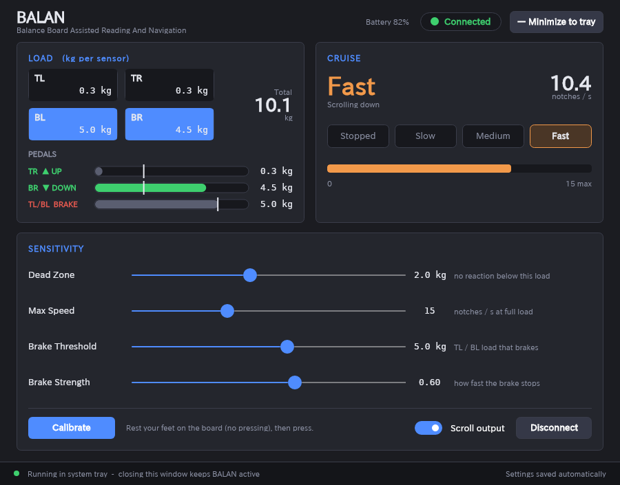

# BALAN

**B**alance Board **A**ssisted **L**earning **A**nd **N**avigation

Wii Balance Board を「足で速度を制御する巡航スクロール」に使う常駐アプリ(Windows / Linux)。座って、足でボードの隅を踏んで操作する。

> **右足で進む。左足で止まる。**



- 右足: **TR = 上スクロール / BR = 下スクロール**(荷重が大きい方が勝つ)。2 kg 未満は無反応、2〜3 kg Slow、3〜4 kg Medium、4 kg 以上 Fast。速度はなめらかなカーブで上がる
- 左足: **TL または BL が 5 kg 以上でブレーキ(既定。画面で調整可)**(アクセルより優先)
- 何も踏まなければ停止。センサー途絶・切断でも停止
- 設計・モック・リスク: [docs/DESIGN.md](docs/DESIGN.md)

## 使い方

```
dotnet run --project src/BALAN.App                 # 実機(Windows)
dotnet run --project src/BALAN.App -- --simulate   # 模擬ボードで画面と巡航を確認
```

1. Connect を押し、ボードの赤い SYNC ボタン(電池ボックス内)を押す
2. 足をボードに載せた状態(押さずに)で **Calibrate**(無操作時の荷重を 0 kg にする)
3. 右足で TR / BR を踏むと上 / 下にスクロール、左足で TL / BL を踏むとブレーキ
4. 設定の **Scroll Mode** で方式を選べます(次回起動時も保持)
   - **Vertical**(既定): 上記の巡航スクロール
   - **Horizontal**: チルトホイール的な左右スクロール。右足(TR / BR)= 右、左足(TL / BL)= 左。ブレーキは使わず、離せば停止。荷重 → 速度の計算は Vertical と共通
5. ウィンドウを閉じる/最小化するとトレイに常駐(終了はトレイメニューの Exit)

起動オプション: `--simulate` `--minimized` `--no-tray` `--no-autoconnect`

### Linux

スクロールは uinput の仮想マウス、接続は BlueZ(`bluetoothctl`)で探索して L2CAP で直結する(KUNAI と同じ方式)。初回だけ権限の設定が必要:

```
sudo cp tools/linux/99-balan.rules /etc/udev/rules.d/
sudo udevadm control --reload-rules && sudo udevadm trigger
sudo usermod -aG input "$USER"     # ログインし直す
sudo modprobe uinput
```

その後は Windows と同じ(Connect → SYNC ボタン)。権限が無いときは、フッターに設定手順つきのエラーが出る。トレイは環境に合わせて XEmbed(Xfce など)→ StatusNotifierItem(KDE・GNOME の拡張など)の順に自動選択し、どちらも無ければ常駐しない(閉じるボタンで終了)。`BALAN_TRAY=xembed|sni|none` で指定できる。

## 開発

```
dotnet build
dotnet test                       # 92 件。実機・OS 不要
python3 docs/gen_mock.py          # UI モック再生成
```

.NET 8 / Avalonia 11 / ReactiveUI。構成は `src/BALAN.{Core,Device,Input,UI,App}`(KUNAI と同じく Core が最内層)。

## ライセンス

MIT License(Copyright (c) 2026 Michihiko Mikami)。[LICENSE](LICENSE) を参照。
