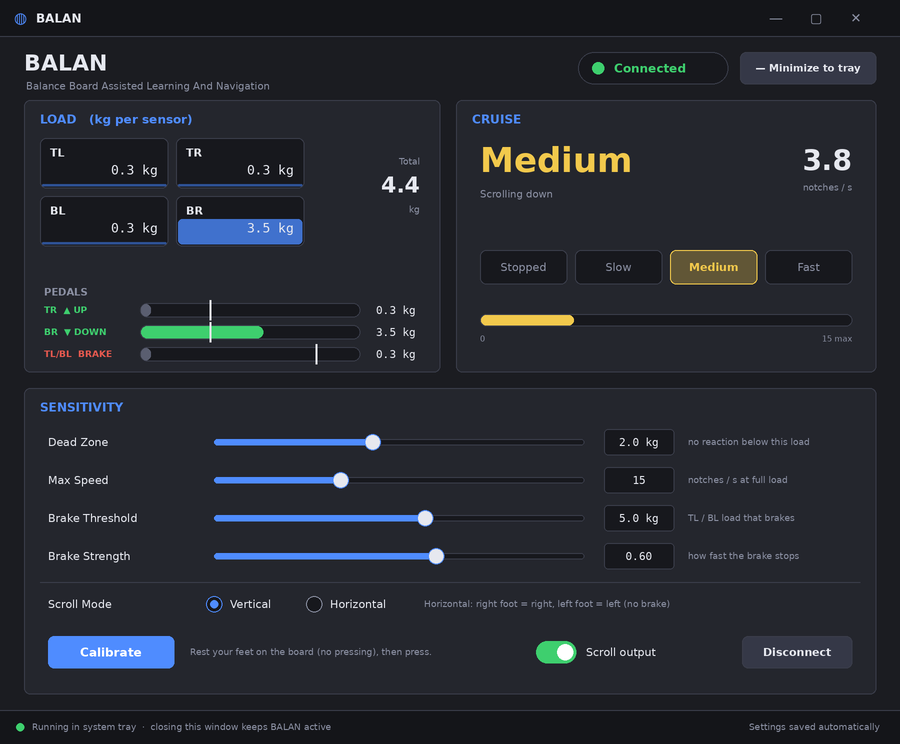

# BALAN 設計書

**B**alance Board **A**ssisted **L**earning **A**nd **N**avigation

> 右足で進む。左足で止まる。
> BALAN は「足でスクロールするツール」ではなく、**情報閲覧速度を足で制御する巡航 UI** である。

## 1. コンセプトと UX 原則

車の運転がメタファー。位置ではなく**速度**を制御する。**座って、足でボードの 4 隅を踏む**使い方を前提にする(荷重はせいぜい 5 kg 程度)。

| 足・センサー | 役割 | 動作 |
|---|---|---|
| 右足 TR(右奥) | アクセル(上) | 荷重 2 kg 未満は無反応。以降、荷重に応じて**上**へ巡航スクロール |
| 右足 BR(右手前) | アクセル(下) | 同上。**下**へ巡航スクロール |
| 左足 TL / BL | ブレーキ | どちらかが 4 kg 以上で減速・停止。アクセルより優先 |
| 何も踏まない | 停止 | 何も起きない |

TR と BR は**荷重の大きい方**が勝つ(両方踏んでも迷わない)。荷重の目安: 2〜3 kg が Slow、3〜4 kg が Medium、4 kg 以上が Fast(5 kg で最大速度)。速度は階段ではなく**なだらかなカーブ**で連続的に上がる。

設計上の優先順位(衝突したら上が勝つ):

1. **思った位置で止められる** — 減速は加速より常に速い。ブレーキ・センサー途絶・切断は即停止
2. **誤作動より無反応** — デッドゾーン(2 kg)、EMA、加速のなだらかさ、逆方向は一度停止してから反転
3. 説明が 1 文で終わる
4. 長時間使っても疲れない・常時起動できる

## 2. UI モック(Phase 1)

- 生成コード: [`gen_mock.py`](gen_mock.py)(`python3 docs/gen_mock.py` / `--states`)
- 画像: [`mock_main.png`](mock_main.png)(Vertical)、[`mock_horizontal.png`](mock_horizontal.png)(Horizontal)、全状態 [`mock_states.png`](mock_states.png)(Vertical: Stopped / Slow / Medium / Fast / Brake、Horizontal: Right / Left、Disconnected)
- 実装の描画結果(Avalonia Headless で出力): [`screenshot_main.png`](screenshot_main.png)(Vertical)、[`screenshot_horizontal.png`](screenshot_horizontal.png)(Horizontal)



モックからの実装上の差分は「最小化(トレイへ)」ボタンをヘッダー右に置いたことだけ(タイトルバーは OS 標準)。初版は立って体重移動する「重心」方式だったが、実機で座って足操作する使い方に合わせ、各センサーの荷重(kg)方式に作り直した(PEDALS メーターの白い縦線が反応が始まる荷重)。その後、Scroll Mode(Vertical / Horizontal)を追加し、モックも現行の画面に合わせた(Horizontal ではブレーキ行を隠し、Brake の 2 つのスライダーを無効表示にする)。

## 3. システムアーキテクチャ

```
        ┌──────────────────────── BALAN.App (Composition Root) ────────────────────────┐
        │  Program.cs : DI 構築 / 起動オプション(--simulate --minimized --no-tray)    │
        └───────┬──────────────┬───────────────────┬───────────────────┬───────────────┘
                ▼              ▼                   ▼                   ▼
        ┌─────────────┐ ┌─────────────┐    ┌─────────────┐     ┌──────────────┐
        │ BALAN.UI    │ │ BALAN.Device│    │ BALAN.Input │     │ (BALAN.Tests)│
        │ Avalonia    │ │ HidSharp    │    │ SendInput   │     └──────────────┘
        │ ReactiveUI  │ │ BT ペアリング│    │             │
        └──────┬──────┘ └──────┬──────┘    └──────┬──────┘
               └───────────────┼──────────────────┘   すべて Core の抽象を実装/利用(依存性逆転)
                               ▼
        ┌────────────────────────────────────────────────────────────────┐
        │ BALAN.Core  (参照ゼロ)                                          │
        │  Domain : SensorFrame / EngineSnapshot / CruiseLevel           │
        │  Cruise : PedalForces / ExponentialFilter / CruiseController   │
        │  Engine : BalanEngine / EngineRunner / BoardEngineBridge       │
        │  Settings : BalanSettings / SettingsService / JsonSettingsStore│
        │  Abstractions : IBalanceBoard / IScrollSender / IClock / IAppLog│
        └────────────────────────────────────────────────────────────────┘
```

依頼の構成(App / UI / Core / Device / Input)をそのまま採用した。KUNAI と同じく **Core を最内層(参照ゼロ)** に置き、Device / Input / UI が Core の抽象を実装する。これにより Core の巡航ロジックは実機・OS・UI なしでテストできる。

### 実行時のデータフロー

```
Wii Balance Board ─Bluetooth HID(0x32 レポート, ~100 Hz)→ BalanceBoardService [Device]
   │  生値 → ボード内蔵較正で kg に変換
   ▼ FrameReceived(SensorFrame: TL TR BL BR kg)         ※読み取りスレッド
BoardEngineBridge [Core] ──→ BalanEngine.OnFrame
                                │ ① 4 センサーそれぞれを EMA で平滑化  filtered = old×0.8 + new×0.2
EngineRunner (10 ms タイマー) ──→ BalanEngine.Tick
                                │ ② 無操作時の荷重(Calibrate で測定)を差し引く
                                │ ③ PedalForces: Up=TR, Down=BR, Brake=max(TL, BL)
                                │ ④ CruiseController.Update(forces, hasData, dt)   → 速度 [notch/s] と方向
                                │ ⑤ 速度 × 時間 を積算し、WheelGranularity 単位で送出(上=正 / 下=負)
                                ▼
                          IScrollSender.SendVertical(±delta) [Input] → Windows: SendInput(MOUSEEVENTF_WHEEL) / Linux: uinput
                                │
                                └─ SnapshotChanged ─(33 ms に間引き, UI スレッド)→ MainViewModel → MainWindow / Tray
```

センサー受信(不定期・別スレッド)と、制御周期(10 ms 固定)を分離している。センサーが 300 ms 途絶えたら「無人」扱いとなり必ず停止するため、切断・電池切れで**スクロールが走りっぱなしにならない**。

## 4. Avalonia 画面構成

```
MainWindow  (900×650, ダークテーマ, DataContext = MainViewModel)
├─ Header     : BALAN / サブタイトル ・ Battery ・ ● Connected|Connecting|Disconnected ・ [— Minimize to tray]
├─ Row 1
│  ├─ LOAD card   : TL TR / BL BR の 4 セル(縦バー + kg) ・ Total
│  │                BalanceIndicator(カスタムコントロール: デッドゾーン・左=赤/右=緑・ノブ)
│  └─ CRUISE card : 段階(Stopped/Slow/Medium/Fast, 大きく色付き) ・ 速度 [notches/s]
│                   4 段ステップ表示 ・ 速度バー
├─ Row 2  SENSITIVITY card
│     Dead Zone(kg) / Max Speed / Brake Threshold(kg) / Brake Strength スライダー(値は即時反映、保存は 0.5 秒デバウンス)
│     [Calibrate] ・ Scroll output スイッチ ・ [Connect / Disconnect]
└─ Footer     : 状態メッセージ(接続の案内・エラー・キャリブレーション結果)
TrayIcon      : 状態色アイコン(赤/黄/緑) ・ ツールチップに現在の段階 ・ メニュー Show / Connect / Exit
```

| ファイル | 役割 |
|---|---|
| `Views/MainWindow.axaml` | 画面(コンパイル済みバインディング) |
| `ViewModels/MainViewModel.cs` | ReactiveUI。エンジン/デバイスの状態 → 表示、設定 ⇄ スライダー、コマンド |
| `Controls/ForceMeter.cs` | 荷重(kg)の横バー + 反応開始のしきい値線 |
| `Styles/BalanTheme.axaml` | 配色(モックと同じ)。OpenRGB/OBS 風の業務ツール調 |
| `Tray/TrayController.cs` | 閉じる/最小化 → 非表示、トレイ、Exit での終了 |

## 5. .NET 8 ソリューション構成

```
BALAN/
├─ BALAN.sln / Directory.Build.props      net8.0, Nullable, TreatWarningsAsErrors
├─ src/
│  ├─ BALAN.Core      データモデル・重心計算・フィルタ・Cruise 制御・エンジン・設定(JSON)
│  ├─ BALAN.Device    Balance Board 接続(HidSharp)・プロトコル・較正・ペアリング(Windows / Linux)・模擬ボード
│  ├─ BALAN.Input     OS へのスクロール送出(Windows: SendInput / Linux: uinput 仮想マウス)
│  ├─ BALAN.UI        Avalonia + ReactiveUI(画面・VM・トレイ)
│  └─ BALAN.App       exe。DI と起動オプション
├─ tests/BALAN.Tests  xUnit(92 件。実機・OS 不要)
├─ docs/              DESIGN.md / gen_mock.py / mock_*.png / screenshot_main.png
└─ assets/            gen_icon.py / アイコン
```

パッケージ: Avalonia 11.3.8、Avalonia.ReactiveUI、HidSharp 2.1.0、Microsoft.Extensions.DependencyInjection。
設定の保存先: `%APPDATA%\BALAN\settings.json`(Linux は `~/.config/BALAN/`)。

起動オプション: `--simulate`(模擬ボード。実機なしで画面と巡航を確認) / `--minimized`(トレイのみで起動) / `--no-tray` / `--no-autoconnect`

## 6. MVP 実装計画と進捗

| Phase | 内容 | 状態 | 検証 |
|---|---|---|---|
| 1 | Python による UI モック(PNG) | 完了 | 画像確認 |
| 2 | Balance Board 接続 | 実装済み | 偽ボードでの接続・再接続・切断テスト。**実機は未検証** |
| 3 | 荷重取得(0x32、kg 変換) | 実装済み | パーサー/較正のテスト。**実機は未検証** |
| 4 | 荷重・ペダル表示 | 完了 | Headless 描画で確認 |
| 5 | 巡航速度計算 | 完了 | 単体テスト(§8) |
| 6 | スクロール送出 | 実装済み | エンジンまでテスト。Windows の SendInput・Linux の uinput とも実機で確認済み |
| 7 | 設定保存(JSON) | 完了 | 往復・破損ファイル・範囲外値のテスト |
| 8 | トレイ常駐 | 実装済み | **画面のある環境では未検証**(コードは KUNAI の方式を踏襲) |

次にやること(優先順):

1. Windows 実機 + Balance Board で、ペアリング → 接続 → kg 値が体重と一致するかを確認
2. 実機の使用感に合わせた DeadZone / FullLoad / BrakeLoad / MaxSpeed の調整(§9 R1)
3. 自動再接続(切断後にバックグラウンドで再スキャン)
4. 起動時の自動実行(スタートアップ登録)
5. Linux 実機での確認(§10)

## 7. Wii Balance Board 通信層設計

### 7.1 プロトコル(BALAN.Device/Protocol)

Balance Board は Wii Remote と同じ HID レポート体系で、荷重は「拡張コントローラ」として届く。VID `057E`、PID は Wii Remote(初代)と**同じ `0306`**のため、拡張 ID で区別する。

| 手順 | 送受信 | 備考 |
|---|---|---|
| 1 | 書込 `0xA400F0 ← 0x55`、`0xA400FB ← 0x00` | 拡張の初期化(暗号化なし) |
| 2 | 読出 `0xA400FA`(6B) = `00 00 A4 20 04 02` | 一致しなければ Wii Remote 等として**閉じて次の候補へ** |
| 3 | 読出 `0xA40024`(24B) | 較正値: 0 / 17 / 34 kg × (TR, BR, TL, BL)。単調増加でなければ失敗扱い |
| 4 | LED1 点灯、レポートモード `0x12 0x04 0x32`、ステータス要求 | 0x04 = 連続送信(変化がなくても ~100 Hz) |
| 5 | 受信 `0x32`: `[ID][btn 2][TR 2][BR 2][TL 2][BL 2]`(BE 16bit) | 較正で kg へ。0〜17 kg / 17〜34 kg を別々に線形補間 |
| — | 受信 `0x20`(ステータス) | レポートモードが戻ることがあるため**都度 0x32 を再設定**。電池残量を更新。60 秒ごとに要求 |

### 7.2 クラス

```
IBalanceBoard (Core)  ◀── BalanceBoardService  : 接続ライフサイクル・読み取りスレッド・イベント
                     ◀── SimulatedBalanceBoard : --simulate 用
BalanceBoardService ──→ IBoardTransport (HidSharpBoardTransport)   : HID の列挙/オープン。HidSharp をここに閉じ込める
                    ──→ IBoardPairing   (WindowsBoardPairing)      : Windows の自動ペアリング(任意)
Protocol/ BoardProtocol(出力レポート組立) / BoardReportParser / BoardCalibration
```

- `ConnectAsync` は見つかるまで(既定 30 秒)スキャンし続ける。見つからなければ `TimeoutException`(案内文付き)
- 切断(IO 例外)・電源断は `Disconnected` として通知。`DisconnectAsync` はスキャン中でも中断できる
- 読み取りは 500 ms タイムアウト付き。無通信でも切断と終了要求を検知できる
- イベントは読み取りスレッドから発火。購読者の例外はデバイス読み取りを止めない

### 7.3 ペアリング

Windows の標準 UI は PIN を要求するが、PIN は Bluetooth アドレスのバイナリ値で手入力できない。`WindowsBoardPairing`(KUNAI の Wii Remote 用実装を移植)が、探索で見つけた `Nintendo RVL-WBC-01` に対し PC 側アダプターのアドレスから PIN を計算して認証し、HID サービスを有効にする。ユーザー操作は**ボードの赤い SYNC ボタン(電池ボックス内)を押す**だけ。Linux は OS 側(`bluetoothctl`)でペアリングする。

## 8. Cruise Controller 詳細設計

### 8.1 信号処理

```
各センサー(TL TR BL BR) → EMA  filtered = old × 0.8 + new × 0.2        100 Hz で時定数 ≈ 45 ms(1 フレームの跳ねを抑える)
                         → 差し引き  max(0, filtered − Tare)             Tare = Calibrate で測った「足を載せただけ」の荷重
PedalForces:  Up = TR    Down = BR    Brake = max(TL, BL)
```

前後・左右の重心は使わない。各センサーの荷重そのものが操作量。

### 8.2 アクセル曲線とブレーキ

```
force = max(Up, Down)                 勝った側が方向を決める(Up > Down なら上、そうでなければ下)
depth = clamp((force − DeadZone) / (FullLoad − DeadZone), 0, 1)       DeadZone 2 kg / FullLoad 5 kg
目標速度 = depth² × MaxSpeed             なめらかな 2 次曲線(階段ではない)

Brake ≥ BrakeLoad(5 kg) → 目標 0。アクセルを踏んだままでもブレーキが勝つ

加速   : 2.0 [MaxSpeed/秒]                  最大速度まで約 0.5 秒。急発進しない
減速   : 4.0 [MaxSpeed/秒](荷重を抜いたとき)
ブレーキ: 4.0 + 20 × BrakeStrength [MaxSpeed/秒]   既定 0.6 で 16/秒 = 最大速度から約 0.06 秒で停止
逆方向 : TR↔BR を切り替えたときは、いったん 0 まで減速してから反転
```

速度の増減は MaxSpeed に対する割合/秒なので、MaxSpeed を変えても操作感は変わらない。

### 8.3 段階表示

段階は「現在の実効荷重」= DeadZone + √(速度割合) × (FullLoad − DeadZone) で決める(目標荷重ではなく実際の速度に追従)。

| 荷重 | 段階 | 速度(MaxSpeed=15) |
|---|---|---|
| < 2 kg | Stopped(無反応) | 0 |
| 2〜3 kg | Slow | 0 〜 1.7 notch/s |
| 3〜4 kg | Medium | 1.7 〜 6.7 notch/s |
| ≥ 4 kg | Fast | 6.7 〜 15(5 kg)notch/s |

境界(2 / 3 / 4 kg)はテストで固定。`DeadZoneKg` を変えると 3 つの境界は DeadZone / +1 / +2 kg に連動して動く。

### 8.4 スクロール送出

速度[notch/s] × 120 × dt を積算し、`WheelGranularity`(既定 30 = 1/4 ノッチ)単位で送る。端数は持ち越すので低速でも滑らか。**上スクロール = 正、下 = 負**のホイール値。dt は 0.1 秒で頭打ち(スリープ復帰で一気に動かない)。キャリブレーション中・Scroll output OFF のときは送出しない。

### 8.5 状態

```
              アクセル ≥ 2 kg                    TL/BL ≥ 5 kg
 Stopped ─────────────────▶ Cruising(上/下) ─────────────────▶ Braking → Stopped
    ▲                           │  逆方向のアクセル → いったん 0 まで減速 → 反転
    └───────────────────────────┴── 荷重を抜く / 切断 / センサー途絶 300 ms で停止
```

### 8.6 キャリブレーション(Tare)

Calibrate → 1.5 秒間、センサー入力が途切れなければ各センサーの平均荷重を `Tare` に保存し、以降差し引く。足を載せているだけで荷重がある場合に、「載せているだけ = 0 kg」にするため。**押さずに足を載せた状態**で行う。測定中にセンサーが途切れた/サンプル不足なら採用しない。測定中はスクロールしない。

### 8.7 設定(`%APPDATA%\BALAN\settings.json`)

| キー | 既定 | 画面 | 意味 |
|---|---|---|---|
| `DeadZoneKg` | 2.0 | ○ | これ未満は無反応 |
| `MaxSpeed` | 15 | ○ | 最大荷重での速度(notch/s) |
| `BrakeStrength` | 0.6 | ○ | ブレーキの効き |
| `FullLoadKg` | 5.0 | JSON のみ | この荷重で最大速度 |
| `BrakeLoadKg` | 5.0 | ○ | TL/BL がこの荷重以上でブレーキ(実機の評価で 5.0) |
| `Tare*` | 0 | Calibrate | 無操作時の荷重 |
| `WheelGranularity` | 30 | JSON のみ | 送出の最小単位(120 = 1 ノッチ) |

初版(重心方式)の設定キー(`DeadZone` `Reach` `BalanceOffset` など)は無視される。

## 9. リスクと対策

| # | リスク | 影響 | 対策 / 現状 |
|---|---|---|---|
| R1 | 足で踏める荷重は小さい(〜5 kg)ため、2 / 4 / 5 kg の既定値が人・姿勢で合わない可能性 | Fast に届かない / 敏感すぎる | 実機の評価で決めた値。`DeadZoneKg` はスライダー、`BrakeLoadKg` もスライダー、`FullLoadKg` は JSON で調整可 |
| R2 | 足を載せているだけで荷重がある(特に BR / TR) / 脚の重みで TL・BL が 4 kg に近づく | 誤スクロール・誤ブレーキ | Calibrate で無操作荷重を差し引く、EMA、デッドゾーン。誤ブレーキは「止まる」側なので安全側 |
| R3 | 止まらない(切断・電池切れ・フリーズ) | 最も不快な事故 | センサー 300 ms 途絶で停止、切断で Reset、送出失敗でも制御ループ継続、ブレーキ全踏みは即停止 |
| R4 | Windows でのペアリング失敗(PIN、スタック差異) | 接続できない | PIN 自動計算で代行(KUNAI の実績ある方式)。失敗時はフッターに案内。OS 側ペアリングでも動く |
| R5 | PID が Wii Remote と同一 | 誤って Wii Remote を掴む | 拡張 ID で判定し、違えば閉じて次の候補へ(テスト済み) |
| R6 | 細かいホイール値(1/4 ノッチ)を無視する/丸めるアプリがある | 低速で動かない・ぎこちない | `WheelGranularity` を設定で変更可(120 で従来の 1 ノッチ) |
| R7 | 管理者権限のウィンドウ(UAC)には SendInput が届かない(UIPI) | そのウィンドウだけ動かない | 仕様上の制限として明記。送出失敗は握りつぶして継続 |
| R8 | ホイールは「マウスカーソル下のウィンドウ」へ届く | キーボードフォーカスと違う場所が動く | 仕様として明記(ブラウザ/PDF 閲覧では自然)。将来、フォーカス追従モードを検討 |
| R9 | 電池残量の換算(0〜200 → %)が Balance Board で正しいか未確認 | 表示が不正確 | 表示のみで制御に無関係。実機で最大値を確認して補正 |
| R10 | ボードの自動電源断・スリープ | 使用中に切れる | 切断を検知して停止。**自動再接続は未実装**(次の優先タスク) |
| R11 | 長時間の足の操作による疲労 | 利用が続かない | 何も踏まなければ何も起きない。踏む荷重が小さい(2 kg〜)。Scroll output スイッチで一時停止可 |
| R12 | トレイ表示の OS 差(GNOME は AppIndicator 拡張が必要) | 常駐に見えない | `--no-tray` で通常ウィンドウ運用。Windows を主対象とする |
| R13 | HidSharp の列挙・読み取りがブロッキング | UI 固まり | スレッドプール/専用スレッドで実行。UI は 33 ms に間引いて反映 |
| R14 | Windows/実機・トレイが未検証のまま出荷される | 実機で初めて判明する不具合 | §6 に未検証箇所を明記。`--simulate` で UI/巡航は検証可能 |

## 10. Linux 対応

KUNAI の Linux 実装を踏襲した。ロジック(巡航・プロトコル・UI)は共通で、OS 依存は Device と Input の差し替えだけ。

| 層 | Windows | Linux |
|---|---|---|
| スクロール送出(Input) | `SendInput`(MOUSEEVENTF_WHEEL) | `LinuxScrollSender`: `/dev/uinput` の仮想マウス。高分解能ホイール `REL_WHEEL_HI_RES`(120 = 1 ノッチ)を毎回、120 たまるごとに従来の `REL_WHEEL` も送る(カーネルの作法)。X11 / Wayland どちらでも動く |
| 接続(Device) | HidSharp | HidSharp(hidraw)+ **L2CAP 直結** |
| ペアリング(Device) | Win32 Bluetooth API で PIN を計算して認証 | `bluetoothctl` で探索し(`Nintendo RVL-WBC-01`)、BlueZ のボンディングを使わず L2CAP(PSM 0x11 / 0x13)で直接接続。確立した接続は `LinuxBoardLink` 経由で `BalanceBoardService` に渡る |
| 権限 | 不要 | `tools/linux/99-balan.rules`(uinput と hidraw)+ `input` グループ |
| トレイ | Avalonia TrayIcon | 環境に合わせて自動選択(下記) |

### トレイの方式(`TrayBackendFactory`、KUNAI から移植)

| 順 | 方式 | 対象 | 実装 |
|---|---|---|---|
| 1 | XEmbed(`_NET_SYSTEM_TRAY`) | Xfce・Enlightenment・KDE(X11)などの従来型 | `X11SystemTray`(専用スレッドで別の X 接続を使う)+ `TrayMenuWindow`(右クリックの簡易メニュー。XEmbed にはメニュー機能が無いため) |
| 2 | StatusNotifierItem(DBus) | KDE、GNOME(AppIndicator 拡張)など | Avalonia 標準の `TrayIcon` |
| — | どちらも無い | — | トレイ常駐しない(隠すと戻れなくなるため、閉じるボタンで終了する) |

環境変数 `BALAN_TRAY=xembed|sni|none` で方式を指定できる。XEmbed にはツールチップが無い。Windows は常に Avalonia 標準。
`ITrayBackend` で方式を差し替えられる構造にし、`TrayController`(閉じる/最小化→非表示)は方式に依存しない。

仮想マウスはホイールだけだとポインタと認識されないことがあるため、相対移動とボタンも宣言した通常のマウスとして作る(実際には動かさない)。権限が無い場合は `IOException` に設定手順が入り、画面のフッターに `Cannot send scroll: ...` と出る(同じエラーは 1 度だけ)。

検証状況: イベント列・バイト列・探索出力の解析・トレイの方針(`TrayPolicy`)・アイコン画像変換(`BgraImage`)は単体テスト済み。WSLg 上で起動して `--simulate` が全トレイ方式の指定で落ちずに動くことは確認した。その後、Linux 実機の Balance Board で動作確認済み(接続・スクロール送出)。ボードが他の端末とペアリング済みの場合は、先に解除が必要(KUNAI と同じ)。

追加のリスク:

| # | リスク | 対策 |
|---|---|---|
| R15 | カーネルの `hid-wiimote` ドライバが Balance Board を先に掴み、hidraw/evdev の挙動が変わる | L2CAP 直結を併用(hidraw に依存しない経路) |
| R16 | GNOME 等でトレイ管理者が無く、表示されない | XEmbed → SNI の順に自動で探し、どちらも無ければ常駐しない。`BALAN_TRAY` で強制も可 |
| R17 | 一部のアプリが高分解能ホイールを無視し、低分解能(1 ノッチ)だけで動く | 両方送出している。低速では 1 ノッチ単位になる |
